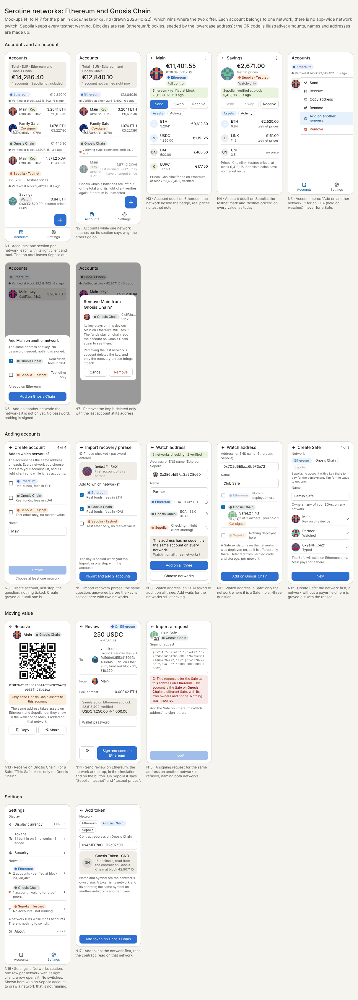

# Networks: Ethereum and Gnosis Chain beside Sepolia

A plan, not yet a ruling (drawn 2026-10-22). Today the app works on Sepolia
alone (owner ruling, 2026-10-15; CLAUDE.md, *Data sources*), and adding a
network is the owner's decision, recorded in CLAUDE.md before its code lands.
This page proposes how Ethereum mainnet (chain id 1) and Gnosis Chain (chain id
100) come in, and what has to be decided first (*Open questions*, at the end).
When the owner accepts it, the rulings it needs go into CLAUDE.md in the first
part's PR, and docs/wallet-ux.md takes over the screens as each part lands.

The mockups (source: `networks-screens.html`, which opens in a browser) are
numbered N1 to N17 below. They follow the style of `wallet-ux-screens.html`:
real blockies, made-up amounts and addresses, an illustrative QR code. Where a
mockup and this text differ, the text wins.

## The three decisions this plan is built on

These come from the owner's request (2026-10-22):

1. **No global switch.** There is no "current network" and no network picker
   for the app. Nothing in Settings turns a network on or off. Every value and
   every action is about one account, and **each account belongs to one
   chain**. A screen takes its network from the account it shows. A screen
   that lists accounts (Accounts, Create Safe's owners and payer, Send's "your
   accounts" chips) shows each account with its network.
2. **Creating an EOA asks which networks to add it to.** Create account and
   Import recovery phrase end with a question: *add to which networks?*
   Ethereum, Gnosis Chain and Sepolia are each a check box. The key is stored
   once. Each network ticked adds one account to the list (N8, N9).
3. **Watching an EOA asks whether to add it on all three.** An address with
   no code is the same account on every EVM chain. When the Watch screen
   detects an EOA, it asks whether to add it on all three networks, with a way
   to choose fewer (N10). A Safe or another contract exists only on the chains
   it was deployed on, and is offered only where it is detected (N11).

And one rule carries over: **the testnet warnings stay on Sepolia accounts**.
"testnet prices" on every fiat value, the "Testnet" mark, "Only send Sepolia
assets" on Receive. They appear wherever a Sepolia account is shown and
nowhere else. Sepolia values are never added into a total with real ones.

## What the engine already offers

Myotis was multichain before Serotine embedded it, and its multichain support
needs nothing new from the engine:

- `MyotisEngine` hosts one `ChainHandle` per network in one process
  (`create(EngineConfig, EnginePorts)`, `get(name)`, `stop(name)`). Each
  network has its own peers, light client and files (the default ports
  suffix them, `peers-gnosis.cache`), and a failure in one network does not
  reach the others. `availableNetworks()` lists `mainnet`, `gnosis` and
  `sepolia`.
- Gnosis Chain has its own beacon chain: 5 s slots, 16 slots an epoch, and a
  sync-committee period of about 11.4 h, against mainnet's 27.3 h. Its light
  client is verified the same way, so the *Trust* rules apply unchanged.
- Each network costs well under 1 MB of disk. While awake, a network costs
  about 2 to 6 MB a minute on mainnet at the engine's defaults, and Gnosis
  polls 2.4 times as often (Myotis docs/disk-and-network-usage.md). That
  cost is why a network runs only while the user has an account on it (*The
  engine host*, below).
- ENS: the registry is pinned for mainnet and Sepolia. **Gnosis has no ENS.**
  Myotis resolves Genome's `.gno` names there instead (open question 2).
- The log index (*History* in docs/embedding-myotis.md) is per network, and
  so are the upgrade advisories (Glamsterdam: live on Sepolia since
  2026-10-06; mainnet and Gnosis have no date yet).

## The model

### `Network`

`Network` gets two entries, and their order is the order of every list on
screen:

| | `ETHEREUM` | `GNOSIS` | `SEPOLIA` |
|---|---|---|---|
| chain id | 1 | 100 | 11155111 |
| display name | Ethereum | Gnosis Chain | Sepolia |
| engine name | `mainnet` | `gnosis` | `sepolia` |
| native currency | ETH, Ether | XDAI, xDAI | ETH, Ether |
| native icon | `eth` | `xdai` (bundled, as every icon) | `eth` |
| native price id | `ETH` | `XDAI` (open question 3) | `ETH` |
| `testnet` | false | false | true |
| seconds per slot | 12 | 5 | 12 |

Each network gets a colour of its own for its mark (N1). The mark always
shows the network's name next to the colour, so colour is never the only
signal.

### An account is an address on a network

- `Account` gets `network: Network`. **An account's identity is the pair
  (network, address)**: `AccountId`, a value class or data class used
  everywhere an account is named today by its address alone. The same EOA on
  Ethereum and on Gnosis is two accounts, with two rows, two names and two
  histories. They share one key.
- `AccountRepository` keys everything by `AccountId`: `add` refuses the same
  pair twice and accepts the same address on another network; `rename`,
  `setCustody` and `remove` take an `AccountId`.
- Routes carry the pair: `account/{chainId}/{address}`,
  `safe/{chainId}/{address}/tx/{hash}`, `safe/{chainId}/{address}/propose`,
  `transfer/{chainId}/{hash}`, and so on. They are still identifiers only.
- **The key is the address's, not the account's.** `EnvelopeKeyStore` keeps
  one envelope per address, as it does today, and the BIP-44 path is the
  same on all three chains (`m/44'/60'/0'/0/0`, which is also what Gnosis
  wallets use). So `RemoveAccount` deletes the envelope only when the account
  removed is the **last** in-key-store account at that address. Removing
  "Main" on Gnosis while "Main" on Ethereum remains asks for the usual
  confirmation, says the key stays for the other network, and deletes
  nothing from the key store (N7).
- **Adding an EOA to another network later** is an action in the account
  menu and on the account's screen: "Add on another network…" (N5, N6). It
  needs no password, because it adds an account to the list and touches no
  key; one held here keeps its custody on the new network. The address is
  detected on the new network first, as Watch does (an EIP-7702 delegation
  is per chain). It is offered for an EOA, held or watched, and never for a
  Safe or another contract. A Safe on another chain is another Safe, so the
  user watches or creates it there.

### Ports take the network; nothing holds a network for the app

Today the composition roots hand `Network.SEPOLIA` to `AppGraph`, and
`AppGraph` hands it to every ViewModel and to many use cases. That injected
network is exactly the global switch this plan rules out, so it goes:

- Every chain port takes the network with each call:
  `NativeBalances.observeBalance(network, address)`,
  `TokenBalances.observeBalance(network, holder, token)`,
  `AddressKinds.observeKind(network, address)`,
  `LightClient.observeStatus(network)`, `NameResolver.resolve(network, name)`,
  `TransactionInputs`, `Broadcaster`, `ReceiptTracker`, `SafeApprovals`,
  `LogIndex`, `PriceFeeds`, `PriceHistory`, `NetworkUpgrades`,
  `UniswapV3Chain` (which takes one already). A network an adapter cannot
  serve is **refused** (an unavailable reading that says why), never answered
  from another network (CLAUDE.md, *Trust*: applied or refused).
- The tables keyed by network stay as they are and gain rows:
  `ChainlinkFeeds.of`, `BuiltInTokens.of`, `SafeDeployments.of`,
  `UniswapDeployments.of`, `PinnedFallbackHandlers.compatibility`, the ENS
  root (`EngineNaming`).
- Use cases and ViewModels lose their `network` constructor argument. A
  ViewModel reads it from the account its route names. A use case gets it
  from the `Account` or `AccountId` it is called with, or from the
  `SigningRequest`, which already carries its chain id. `TokenCatalog`,
  `UserTokens` (added and hidden tokens keyed by network and address) and
  `JsonSigningRequestCodec` (which decodes every known chain id and leaves
  "is it this Safe's network?" to `ImportSigningRequest`) follow.
- Text helpers that take a network today (`balanceText`, `valuationText`,
  `totalNote`, `priceHintText`, `callRefusalText`, …) keep taking it. That is
  where "testnet prices" and the native symbol come from, so the Sepolia
  warnings stay where they are, now driven by the account's network.

### Files

Every file beside the account list that holds per-account or per-chain data
gets the network, in a new version of its `VersionedJsonFile`. **An entry from
the version before is migrated as Sepolia**, since every existing account is
a Sepolia one:

| file | gains |
|---|---|
| `accounts.json` | each account's chain id |
| `tokens.json` | added and hidden tokens keyed by chain id and address |
| `last-balances.json` | the chain id in each key |
| `history-starts.json`, `transaction-history.json` | the chain id in each key |
| `sent-transfers.json` | each record's chain id (today only inside its signed bytes): the nonce floor and the held-back cost `QuoteTransfer` reads are per (network, account), since the same EOA counts its nonces on each chain apart |
| `safe-tx-queue.json` | nothing: each request carries its chain id already; lookups by Safe become by `AccountId` |
| `last-exchange-rate.json` | one entry per network (*The widget*); the widgets placed before the update are Sepolia's, the only rate they could show |
| `upgrade.json` | one known upgrade per network |

The key store's envelopes and `display-currency.json` are not per network and
are unchanged.

## The engine host

- **One engine, one handle per network.** `MyotisNode` today is one engine
  hosting one chain. It splits into the process's `MyotisHost` (the engine,
  its ports, pause and resume, the log pump) and a `ChainNode` per network
  (the handle, `ProvenReads`, the adapters of that chain). The ports'
  adapters in `:data` route each call to the `ChainNode` of its network. The
  iOS `MyotisNode` twin splits the same way.
- **A network runs while it is needed, and only then.** No switch decides
  this; the account list does. A network's handle is created and started
  when the first account on it is added (or at launch, when one exists), or
  while a screen asks about a network with no account yet (the Watch screen
  checking an address on all three, N10). It is stopped 30 s after its last
  account is removed and no screen asks. Pause and resume (Android's 30 s
  after the last hold, the desktop's window) apply to all running networks at
  once. A user with only Ethereum accounts never syncs Gnosis or Sepolia.
- **Background work** follows the same rule. The daily upgrade check runs per
  network with accounts. The widget's refresh wakes only its own network.
- **Last balances** stay per (network, address), so a restart shows each
  network's balances as last verified, with that network's own head time.

## Values: prices, totals, tokens

- **Each account is priced on its own network**, with that network's pinned
  Chainlink feeds read through that network's light client. An Ethereum
  account's USDC is priced by mainnet's USDC/USD feed, a Gnosis account's by
  Gnosis's, and a Sepolia account's by Sepolia's testnet feed, marked "testnet
  prices" as today. No price crosses networks: a Gnosis token without a feed
  on Gnosis has no price, even if mainnet has one for "the same" token.
- **The display currency's rate** comes from the account's own network too.
  A network without that currency's feed says so once in its section ("No CHF
  rate on Gnosis Chain") and its accounts stay out of the total. Display
  currency (19) lists every currency at least one network with an account
  can price (open question 5).
- **The total on Accounts adds mainnet and Gnosis only.** Sepolia's accounts
  have their own subtotal in their section, marked "testnet prices", and
  are never added to the real one (N1). With only Sepolia accounts, the
  header is that testnet total, marked as today.
- **The token list is built in per network** (the ruling of 2026-10-16
  applies per network): a pinned list for Ethereum and one for Gnosis, each
  entry checked against the contract's own `symbol()` and `decimals()` by
  the PR that adds it and by the app at every run, each with a bundled icon.
  The owner picks the entries, as for Sepolia. Candidates: Ethereum's USDC,
  USDT, DAI, WETH, WBTC, LINK, UNI, EURC, PYUSD, GHO and AAVE; Gnosis's WXDAI,
  USDC (Circle's native and the bridged USDC.e are two tokens, both
  labelled), USDT, WETH, GNO, EURe and sDAI. A token's symbol is never taken
  as the same token on another network.
- **Settings → Tokens** groups the list by network. **Add token** asks for
  the network first (N17), then reads the contract on that network.
- **Multicall3** is pinned per network (its code hash proven on each) before
  any batch trusts it, as the Sepolia plan already says.

## Safes and swaps

- **SafeDeployments gets a table per network.** The canonical 1.3.0, 1.4.1 and
  1.5.0 singletons, L1 and L2, and their factories' proxy runtime hashes,
  each proven on that network's chain by its PR, as Sepolia's were.
  Detection, the guards, the modules and the fallback handler rules
  (CLAUDE.md, *Trust*) stay the same. `PinnedFallbackHandlers` gets each
  network's CompatibilityFallbackHandler 1.4.1.
- **Creating a Safe** picks the network first (N12). Its payer must be an EOA
  held here **on that network**. Its owners may be any of the wallet's EOAs
  (an address is an owner on any chain), listed once each, whatever networks
  they were added on. The release follows Safe{Wallet}'s choice per network:
  the L1 singleton on Ethereum and on Sepolia (as today), SafeL2 on Gnosis
  (open question 6). The new Safe is listed on that network only.
- **A signing request** already carries the chain id. Import accepts it only
  on the Safe of that network. A request for the same address on another
  network is refused, and the refusal names both networks ("This request is
  for the Safe on Ethereum; this account is the Safe on Gnosis Chain", N15).
  Today's "not Sepolia" becomes "not a network this wallet supports".
- **Swaps** (docs/swaps.md) use the Uniswap v3 deployment pinned for the
  account's network. Ethereum's canonical deployment is pinned like
  Sepolia's. On Gnosis, Swap is greyed out with the reason ("No swap venue is
  pinned on Gnosis Chain yet") until a deployment is pinned and its code
  proven (open question 7).

## Names

- An ENS name is resolved on the **account's network's** registry: Ethereum's
  on mainnet ENS, Sepolia's on Sepolia's, as today. What is signed is still
  the address, shown in full.
- **Gnosis has no ENS.** Until open question 2 is decided, a Gnosis account's
  Send and Watch take addresses only, and the field says names are not
  resolved on Gnosis Chain yet. A name typed there is refused with that
  reason, never resolved on another chain without a ruling.
- **Watch by name** resolves the name on Ethereum's and Sepolia's registries,
  never on Gnosis. Where the two give different addresses, they are different
  accounts, and the "all three" question is not offered for them. Where the
  name gives one address and that address is an EOA, the question is
  offered (N10). Gnosis then watches **that address**, which the user sees in
  full before Add. The Gnosis account is added by address: it has no
  `ensName` and does not follow the name, since no Gnosis registry was asked.
  The Ethereum and Sepolia accounts follow it as today (issue #67).

## Screens

N1 to N17 below. Every other screen keeps its design and gains the account's
network where docs/wallet-ux.md has it say "Sepolia" today.

### Accounts and an account

- **N1 Accounts**: one section per network with accounts, in `Network`
  order. Each header shows the network's mark, its light-client dot and line
  ("Verified at block N · 8 s ago", in the colours of the status strip), and
  the section's total. The top total adds Ethereum and Gnosis. Sepolia's
  section header says "Testnet". Its total and every row's value say
  "testnet prices", and it is never in the top total. A network's status
  strip is its section header. The strip that spans the screen today becomes
  a summary only when every network shares one state.
- **N2 Accounts, one network catching up**: the section of a network whose
  light client is not verifying shows why ("Gnosis Chain: verifying
  sync-committee periods, 3 of 7"). Its rows show last-verified balances (the
  rule of 2026-10-19, per network) and the other sections are unaffected.
- **N3 Account detail, Ethereum**: the network's mark beside the control
  badge, real prices with no testnet note. Send, Swap and Receive as today.
- **N4 Account detail, Sepolia**: the same screen with the "Testnet" mark and
  "testnet prices" on every value and the footnote, as today.
- **N5 Account menu**: today's items plus "Add on another network…" for an
  EOA, held or watched. The account's own screen has it in its top-bar menu.
- **N6 Add on another network**: a short sheet with the networks the
  account is not on yet, and Add. No password: nothing is signed.
- **N7 Remove**: removing one network's account of a key held here says
  the key stays for the other networks. Removing the last one says what it
  says today: only the recovery phrase brings it back.

### Adding accounts

- **N8 Create account, last step**: after the phrase, the check and the
  password, "Add to which networks?" with the three networks as check boxes,
  **none ticked** (the question is asked, not pre-answered; open question 8),
  each with one line ("Real funds", "Real funds, fees in xDAI", "Testnet: test
  ether only"). Create is greyed out until one is ticked; a tap on it says
  so. The key is sealed once; one account per network ticked is added under
  the name given.
- **N9 Import recovery phrase**: the same question, the last thing asked
  before Import.
- **The key is sealed only together with its accounts.** The network
  question is answered before the seal, never after it. Then the seal and
  the accounts are added in one step that a cancelled caller cannot cut in
  half, as `ImportMnemonicAccount` already does for its one account: key
  first, then the accounts. So no envelope is ever left without an account
  pointing at it, and `RemoveAccount`'s last-account rule always has one to
  find. An address already watched on some networks becomes held there,
  whether or not those networks were ticked, and the ticked ones add the
  rest.
- **N10 Watch address, an EOA**: the address (or a name, on Ethereum or
  Sepolia), then the detection per network, each row with what the network
  says (EOA, and the native balance once verified). When the address is an
  EOA, the screen asks: "This address has no code. Watch it on all three
  networks?", with **Add on all three** and **Choose networks**. Choose
  shows the rows as check boxes. A network still checking says so, and Add
  waits for the networks chosen.
- **N11 Watch address, a Safe**: a Safe is detected per network. Only the
  networks where it is a Safe are offered (each with its `t/n` and owners,
  which may differ per network), and the all-three question is not asked.
- **N12 Create Safe 1/3**: the network as the first choice (chips with the
  network mark), then the name and owners as today. The payer, on 3/3, is
  chosen among this network's held EOAs. Without one on the chosen network
  the chip is greyed out and says which accounts would do.

### Moving value

- **N13 Receive, Gnosis**: "Only send Gnosis Chain assets to this account". For
  an EOA it adds that the same address works on the other networks once the
  account is added there. For a Safe: "This Safe exists only on Gnosis
  Chain". On Sepolia the warning reads as today.
- **N14 Send review, Ethereum**: the network named at the top of the review
  ("On Ethereum"), its fee in the native currency, and no testnet note. The
  same review on Sepolia keeps "Sepolia · testnet" and "testnet prices". The
  "your accounts" chips under To list only accounts on the sender's network.
- **N15 Import signing request, wrong network**: the refusal naming both
  networks.

### Settings

- **N16 Settings**: the Network row becomes a **Networks** section. One row
  per network shows its accounts and its light client ("2 accounts · Verified
  at block N", "No accounts · not running"). A row opens that network's light
  client. There are no switches: a network runs because it has accounts.
  (The mockup has no Sepolia account, unlike N1, so that it can draw a
  network that is not running.)
- **N17 Add token**: the network first, then the address, read on that
  network.

### Upgrades and the update screen

Upgrade advisories are per network, and so are the banner and the
notifications ("Network upgrade ahead on Gnosis Chain: update Serotine"). The
update screen, which replaces every other, is Myotis's rule for a host that
follows one network. With several networks, the plan is that it shows only
when **every network with accounts** is blocked. A network blocked alone
turns its section red, with the update reason and the way to the update, and
greys out its accounts' actions with that reason (open question 4).

### The widget

Each placed widget shows one network's native rate. Android's widget
configuration asks for the network when it is placed, offering the networks
with accounts. A Sepolia widget keeps "testnet prices"; an Ethereum one shows
ETH at mainnet's rate, a Gnosis one xDAI at its rate. Each refresh wakes only
that network. A widget placed before the update has no network in its state
and is migrated as Sepolia, still marked "testnet prices". Choosing another
network means placing a new widget.

## Delivery: a multi-PR plan through `feature/networks`

Per CLAUDE.md (*Multi-PR plans land through a feature branch*), nothing of this
reaches `main` before the whole of it. `main` stays Sepolia-only and
releasable. The parts, in order:

1. **Network-aware model, Sepolia only.** `AccountId`, `Account.network`,
   ports that take the network, the files' new versions with the migration
   as Sepolia, routes by `(chainId, address)`, ViewModels and use cases
   without an injected network, `RemoveAccount`'s last-account rule. The
   rulings this plan needs go into CLAUDE.md here. No visible change.
2. **The engine host.** `MyotisHost` and `ChainNode` (JVM and iOS), the
   per-network routing, starting and stopping a network with its accounts,
   the background jobs per network. Still Sepolia only, so it is tested
   against Sepolia and a fake second network.
3. **The screens.** N1 to N17 with Sepolia as the only real network. Previews
   and screen tests use made-up Ethereum and Gnosis states, and the network
   steps are tested against a fake two-network catalog. The screenshots
   artifact shows them.
4. **Ethereum.** `Network.ETHEREUM`; its Chainlink feeds, built-in tokens
   and icons, Safe deployments and fallback handler, Uniswap v3 and
   Multicall3 pins, each proven on mainnet by the PR, with the values read
   stated; the ENS root. A real-network test like `MyotisNodeSepoliaTest`.
5. **Gnosis Chain.** `Network.GNOSIS`; the xDAI icon and price, its feeds,
   tokens, Safe deployments (L2), fallback handler, and what open questions 2
   and 7 decide for names and swaps.
6. **The final PR** `feature/networks` → `main`, after the internal review of
   the whole diff. Mainnet starts holding real value with this release.

Parts 4 and 5 are independent once 3 is in and can be reviewed in either
order.

**Still the owner's to answer before part 1 is coded** (CLAUDE.md, step 3
of the multi-PR rule): may the part PRs be merged into `feature/networks`
without waiting for the owner, or does the owner merge each one? The answer
lives in the conversation where it is given. Until a session has it in its
own conversation, the owner merges each part.

## Open questions, the owner's to decide

1. **Real funds.** Mainnet and Gnosis hold real value. Should the first
   account added on either show a one-time notice (what Serotine is, what
   is verified, that it is new software)? Or is the "Real funds" line in
   the network step (N8) enough?
2. **Names on Gnosis Chain.** (a) none, addresses only (the plan's default);
   (b) Genome's `.gno` names, which Myotis resolves on Gnosis; (c) ENS names
   on mainnet with an ENSIP-11/19 chain-specific address for Gnosis, which
   needs the mainnet light client for a Gnosis account's Send.
3. **xDAI's price.** xDAI is bridged DAI, redeemable 1:1. Its price is
   Chainlink's xDAI/USD feed on Gnosis if the feed directory lists one, and
   otherwise DAI/USD read on Gnosis. Is DAI/USD acceptable as xDAI's price?
4. **The update screen with several networks**: only when every network with
   accounts is blocked (the plan), or whenever any one is (Myotis's rule as
   written)?
5. **Display currency across networks**: list a currency any network with
   accounts can price, and say per section where it cannot (the plan), or
   only the currencies every such network can price?
6. **Which Safe release to create on Gnosis**: SafeL2 1.4.1 (Safe{Wallet}'s
   choice there; the plan), or the L1 singleton as on Ethereum?
7. **Swaps on Gnosis**: pin Uniswap v3's Gnosis deployment (if its code and
   liquidity hold up), or leave Swap greyed out there until CoW's ruling?
8. **The network step's default**: nothing ticked (the plan; the user
   answers), or Ethereum ticked?
9. **The built-in token lists** for Ethereum and Gnosis: which of the
   candidates above, as for Sepolia's list.
