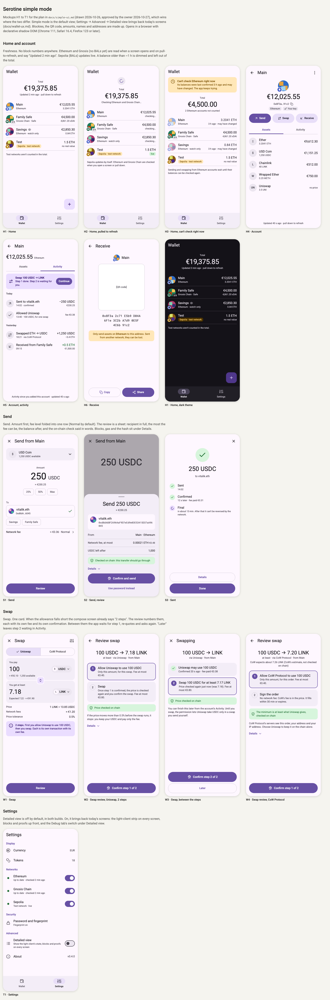

# Simple mode: the default view, with today's screens opt-in

Drawn 2026-10-26 and approved by the owner on 2026-10-27, with the decisions
in *The decisions this plan is built on*. The rulings are recorded in
`.claude/rules/trust.md` and `.claude/rules/ui.md`, and docs/wallet-ux.md
applies them. This page says what simple mode shows and how it is built. It
also says how the parts of `feature/simple-ui` deliver it. docs/wallet-ux.md
takes over each screen as its part lands. Where this page and the rules under
`.claude/` disagree, the rules win and this page is fixed.

The mockups (source: `simple-ui-screens.html`, which opens in a browser) are
numbered H1 to T1 below. The blockies, the QR code, the amounts, names and
addresses are made up. Where a mockup and this text differ, the text wins.

## The decisions this plan is built on

These come from the owner's requests and answers (2026-10-26, mockups
approved 2026-10-27):

1. **Two views of the same wallet.** Simple mode is for people who use the
   wallet. Detailed view is today's screens, for those who want to see how
   the wallet checks the chain. Settings → Advanced → *Detailed view* turns
   it on. It is off by default.
2. **Simple mode in both builds.** The release and the debug app both start
   in simple mode. Detailed view is opt-in in both.
3. **No block numbers in simple mode.** The time since the last verified head
   is fine to show ("Updated 2 min ago"). The block stays one tap away, under
   *Details*.
4. **Live where the network allows it, refreshed on demand where it does
   not.** A network with block access lists (EIP-7928, BALs) updates the
   screen as it changes: today Sepolia, live since Glamsterdam. On Ethereum
   and Gnosis Chain, which have none yet, a value is read when its screen
   opens. Pull-to-refresh reads it again. In between it may grow old, and
   the screen says how old. This holds in simple mode only. Detailed view
   reads at every head, as today.
5. **A balance read a while ago counts, with its age.** In simple mode, a
   balance on a network without BALs counts in totals, at the price read
   with it, while it is under an hour old (the owner's "about an hour",
   pinned at 60 minutes) and the light client verifies. The screen shows its
   age. An older one is dimmed and left out of totals, as a balance last
   verified is today (docs/wallet-ux.md, *Rules every screen follows*).
6. **Swaps much simpler, two steps said out loud.** When the allowance falls
   short, the swap screen says "2 steps" before the review. The review
   numbers them, each with its own fee and its own confirmation.
7. **The Safe's threshold stays on its blockie, and the network joins it**
   (owner's request, 2026-10-27). In simple mode an account's blockie
   carries its network's icon in one corner and, for a Safe, its `t/n`
   threshold in the other.
8. **A check said with care.** The send review says "Checked on chain: this
   transfer should go through", not that it will (owner's request,
   2026-10-27). The check runs the transfer at the latest verified head, and
   another transaction can land first.

## What stays the same

Simple mode changes how the wallet presents what it knows. It does not
change what it trusts.

- Every value is verified by the light client or shown as not available.
- A quote, a review and a signature read fresh state, whatever the screen
  showed before: the rules of docs/wallet-ux.md for Send and Safe
  transactions, and of docs/swaps.md for swaps, apply unchanged.
- Sepolia keeps every testnet warning and is never added to a total with
  real funds.
- A network-upgrade warning says that peers report it.
- A missing prerequisite greys an action out (owner ruling, 2026-10-18,
  #55).
- Every address has a blockie. An address is shown in full where the user
  confirms it.
- Every screen has previews, now one set per view.

## Two views, one set of ViewModels

- **The setting.** A domain port `InterfaceModeSetting`
  (`observe(): Flow<InterfaceMode>`, `set(mode)`), with
  `InterfaceMode { SIMPLE, DETAILED }` and the use cases
  `ObserveInterfaceMode` and `SetInterfaceMode`. Its adapter,
  `FileInterfaceMode`, keeps it in `ui-mode.json` with the app's other files.
  A file that is missing or damaged reads as SIMPLE. The three hosts wire it
  as they wire `FileDebugScreen`.
- **One ViewModel, two screens.** An app-scoped `InterfaceModeViewModel`
  exposes the mode, as `DebugTabViewModel` exposes the Debug tab. Each
  `<Feature>Route` draws `Simple<Feature>Screen` or today's
  `<Feature>Screen` from the same UiState. A screen without a simple version
  yet draws the detailed one, so the switch works from the first part.
- **Leaves, not flags.** Where simple mode says something else (an age where
  detailed view names a block), the UiState gets a display-ready leaf of its
  own, such as `AccountsUiState.Ready.freshness`. A screen never interprets
  a mode flag.
- **Previews and tests.** Each `Simple<Feature>Screen` has
  `Simple<Feature>ScreenPreviews.kt`, its previews test and its headless
  screen tests, as every screen does (`.claude/rules/ui.md`).
- **The Debug tab's switch** moves to Settings → Advanced, under the
  *Detailed view* row, and is shown only while Detailed view is on. Turning
  Detailed view off hides the Debug tab as well and keeps its switch, so
  the tab is back once Detailed view is on again.

## Freshness and pull-to-refresh

- **Live or not.** A domain port `NetworkFreshness` says, per network,
  whether it is live: the engine has BAL account coverage at its readable
  verified head (`AddressActivity.hasAccountCoverage`). `MyotisHost`
  implements it.
- **Refreshing.** The use case `RefreshNetworkData(networks)` proves the
  balances and prices of those networks again, now, for every screen that
  shows them, and wakes their polls at once. Home offers `refresh()` for
  every network, an account for its own: what pull-to-refresh asks.
- **Opening is reading.** A screen, or any one-shot read, that starts
  reading a value gets a fresh proof, at the current head. Only a reader
  that has had one may be held a proof across heads. So a screen shows
  fresh values as it opens, and a quote, a review and a signature always
  read fresh state, in either view.
- **On demand.** Each network has a `ProofSchedule`, which its native
  balances, token balances and prices share. In simple mode
  (`FollowInterfaceMode`, run by the hosts), on a network that is not live,
  a proof stands across heads until a refresh or until it is an hour old,
  and is then made again. A live network keeps its per-head reads: its block
  access lists say which accounts a head touched, so only those are read
  again. Detailed view proves at every head, as before.
- **How old a value is.** A balance reading carries the time of the
  verified head it was proven at (`BalanceReading.Verified.provenAt`,
  `TokenBalanceReading.Verified.provenAt`), so a screen can say how old it
  is.
- **What the screen says.** A display-ready line in the Home UiState
  (`AccountsUiState.Ready.freshness`), re-dated every second:
  - "Live" on a network with BALs;
  - "Updated 2 min ago · pull down to refresh", the age of the oldest value
    the screen shows;
  - "Checking Ethereum and Gnosis Chain…" while a refresh runs;
  - "Can't check Ethereum right now", with the age of what is shown, when
    the light client cannot verify (H3).
- **Pull-to-refresh** (M3 `PullToRefreshBox`) on Home, Account and its
  Activity. It refreshes every network the screen shows. A Refresh button
  in the top bar does the same, so the gesture is never the only way (a
  mouse, a keyboard, a screen reader).
- **The light client's state.** Detailed view keeps the status strip on
  every screen whose content or actions depend on it (owner's request,
  2026-10-20). Simple mode replaces it with the freshness line, a banner
  when a network cannot be checked (H3), and each network's state in
  Settings (T1). An action the light client blocks is greyed out and says
  why, in both views.

## Screens

### Home and account

- **H1 · Home.** The total in the display currency, with "Updated 2 min ago
  · pull down to refresh" under it. Then one row per account: its blockie
  with the network icon (and a Safe's `t/n`), its name, its network (and
  "Safe" or "watch only"), its value and its native balance. A Sepolia
  account says "Sepolia · test network" and "no real value", and the list
  ends with "Test networks aren't counted in the total." The add button,
  and the Wallet | Settings bar. No network sections and no status strip:
  those are Detailed view's.
- **H2 · Home, pulled to refresh.** The spinner, and "Checking Ethereum and
  Gnosis Chain…" under the total, until a newer proof is shown (15 s at
  most). A wallet on live networks alone ("Live") needs no spinner. The
  mockup's per-row "checking…" and "live" are not built: the line under the
  total says it for the list.
- **H3 · Home, can't check right now.** A banner: "Can't check Ethereum
  right now", when its balances were last confirmed, that they may have
  changed, that sending from its accounts waits, and that the app keeps
  trying. It shows too for a light client with no fresh head to read at,
  with no balances from before. The rows of that network are
  dimmed, with "3 h ago · may have changed". The total leaves them out and
  says how many it does not count. A line says that sending and swapping
  from them wait until their balances can be checked again.
- **H4 · Account.** The blockie, the account's value, its short address
  with Copy, and chips for its network and its control ("Your key", "2 of 3
  sign", "Watch only"). Send, Swap and Receive. The Assets | Activity tabs.
  Each asset row has its icon, its name, its balance and its value, or "no
  price". "Updated 40 s ago · pull down to refresh" under the total, as
  on Home.
- **H5 · Account, Activity.** A card on top for a swap whose step 2 waits:
  "Swap 100 USDC → LINK · Step 1 done. Step 2 is waiting for you."
  with Continue (part 6). Then the rows, newest first: what happened, when
  it was sent or signed here (an event on chain is dated only by its block,
  so its row has no time), and how it ended in words ("Confirmed", "Final",
  "Failed", "Filled"), never a block number. Above them "Activity since you
  added it" (or since it was deployed from this device), and "older
  activity is still being checked" while it is. The mockup's day headings
  and amounts' values are not built yet.
- **H6 · Receive.** The account's blockie and name, the QR code, the full
  address in groups of four, "Only send assets on Ethereum to this address",
  with what happens otherwise, and Copy and Share.

### Send

- **S1 · Send.** The asset with what is available. The amount, large, with
  25%, 50% and Max. The recipient: an address or an ENS name, with the
  resolved address under it, and the user's own accounts as chips. One fee
  row: "Network fee ≈ €0.36 · Normal ›", which opens the fee levels. Review.
  Send proves the balance it offers when it opens, so the available amount,
  25%, 50% and Max never come from an aged balance.
- **S2 · Send, review.** A sheet over the form: "Send 250 USDC" and its
  value, the recipient in full with its blockie, From with its network, the
  most the fee can be in the native token and its value, and the balance
  after. "Checked on chain: this transfer should go through" (decision 8).
  Details (the block, the gas limit, the fee caps, the nonce). "Confirm and
  send" with biometrics, or "Use password instead".
- **S3 · Sent.** The amount and the recipient, then Sent → Confirmed (when,
  and the fee paid) → Final ("in about 13 min. After that it can't be
  reversed by the network."). Details (the hash, the blocks) and Done.

### Swap

- **W1 · Swap.** The venue as two choices, Uniswap | CoW Protocol: the user
  chooses each swap's venue (owner's directions, 2026-10-18 and
  2026-10-22). "You pay" and "You get at least", each a card with its token,
  and the flip button between them. The price, the network fees, the price
  tolerance (behind the settings icon). When the allowance falls short, an
  info box: "2 steps. First you allow Uniswap to use 100 USDC, then you
  swap. Each is its own transaction with its own fee." Review.
- **W2 · Swap review, Uniswap, 2 steps.** The swap in one line ("100 USDC →
  7.18 LINK, at least · via Uniswap · from Main"). Step 1, "Allow Uniswap to
  use 100 USDC: only this amount, for this swap", with its fee. Step 2,
  "Swap: once step 1 is confirmed, the price is checked again and you
  confirm the swap", with its fee. "Price checked on chain". What happens
  if the price moves past the tolerance. Details (the route, the pool, the
  router, the block). "Confirm step 1 of 2".
- **W3 · Swap, between the steps.** Step 1 done ("Confirmed 20 s ago · fee
  paid €0.38"). Step 2 quoted again: "Swap 100 USDC for at least 7.17 LINK.
  Price checked again just now (was 7.18)". "Confirm step 2 of 2", or Later.
  Later leaves step 2 waiting in the account's Activity (H5), and says that
  the permission lets Uniswap take the token only in a swap the user sends.
- **W4 · Swap review, CoW Protocol.** The signed minimum ("100 USDC → 7.20
  LINK, at least"), and CoW's estimate marked "CoW's estimate, not checked
  on chain". Step 1, allow CoW Protocol to use 100 USDC. Step 2, "Sign the
  order: no network fee, CoW's fee is in the price, it fills within 30 min
  or expires". "The minimum is at least what Uniswap gives, checked on
  chain". What CoW's servers see: the order, the address and the IP
  address, and that Uniswap keeps it on the chain alone (owner ruling,
  2026-10-22). Details. "Confirm step 1 of 2".

A swap whose allowance already suffices has one step: its review is W2
without the numbered steps, and says "Confirm swap". It has no mockup of its
own.

**Between the steps** (`ApprovalPending`, a new step of `SwapUiState` that
both views share). Today, once the approval is broadcast, the swap screen
returns to its form and the user presses Review again. Instead, the screen
waits for the approval's verified receipt, then quotes step 2 itself, with a
fresh quote and its own confirmation (W3). Nothing is signed for step 2
before the user confirms it. A step 2 left for later is kept as the swap's
inputs (the pair, the amount, the venue, the tolerance), never as a quote or
a signature, and Continue (H5) quotes it again. Part 5 decides where it is
kept.

### Settings

- **T1 · Settings.** Display: Currency, Tokens. Networks: each with its
  switch and its state ("Up to date", "Test network · live", "Catching
  up…", "Can't check right now", "Off"). Security: password and
  fingerprint. Advanced: *Detailed view* ("Show the light client's state,
  blocks and proofs on every screen"), off by default: what Detailed view
  shows up front, since simple mode keeps the fee levels behind a row and
  the blocks under *Details*. About, with the version.

### Not in simple mode yet

A Safe's transaction screens (propose, co-sign, execute, import), Create
Safe, Watch address, Create account and Import draw their detailed screens in
both views until a later part gives them a simple one. The Debug tab is
Detailed view's alone.

## Delivery: a multi-PR plan through `feature/simple-ui`

`feature/simple-ui` was created from `main` on 2026-10-26. Each part is a PR
into it. The owner allowed the parts to be merged into it without asking
(2026-10-26). The final PR, `feature/simple-ui` → `main`, is the owner's to
merge.

0. This page, its mockups, and the rulings in `.claude/rules/` and
   docs/wallet-ux.md.
1. The mode setting: the port, the adapter, the hosts, the Settings switch,
   and each Route choosing its screen.
2. Freshness and refresh: `NetworkFreshness`, `RefreshNetworkData`, the data
   layer's on-demand reads, the proof's time in the readings, and
   `refresh()` in the Home and account ViewModels.
3. Simple Home and Settings (H1 to H3, T1): the freshness line, the "can't
   check" banner, pull-to-refresh with a Refresh button beside it, and the
   network's icon on an account's blockie.
4. Simple Account and its Activity tab (H4, H5). Receive (H6) draws the
   same in both views: it names no block.
5. Simple Send (S1 to S3).
6. Simple Swap for both venues, and `ApprovalPending` (W1 to W4).
7. The remaining flows: Activity's waiting step, and the screens under *Not
   in simple mode yet* that get a simple version.

Then the final PR into `main`.
