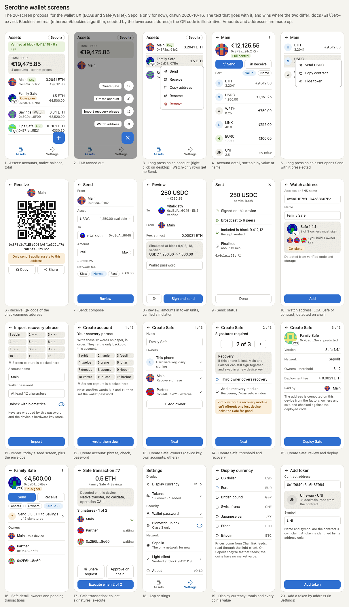

# Wallet UX: EOAs and Safe{Wallet}

The screens Serotine is built towards, for externally owned accounts and Safe
smart accounts, and the rules they follow. A screen PR is held to this page
together with docs/architecture.md (how a screen is built) and
docs/keys-and-signing.md (how a key is held and used). The rules here apply
CLAUDE.md's *Trust* and *Data sources* sections to the screens; where this
page and CLAUDE.md disagree, CLAUDE.md wins and this page is fixed.

The mockups below (source: `wallet-ux-screens.html`, which opens in a
browser) draw the 20 screens with their numbers. They are a sketch: the
blockies are real, the QR code, amounts and addresses are not, the account
rows abbreviate the control badges, and the token rows show monograms where
a built-in token gets its bundled icon. Where a mockup and this text differ,
the text wins.

## Rules every screen follows

- **Sepolia only, and named.** The app works on Sepolia alone (owner ruling,
  2026-10-15), so there is no network picker; a plain label says "Sepolia" on
  the screens that matter for it (Assets, Receive, Send review, Settings). Every
  table this page mentions (tokens, price feeds, Safe singletons) is keyed by
  `Network`, so another network is a data addition once the owner allows it.
- **Verified, or not available.** Every chain value comes from the embedded
  Myotis engine. When the engine cannot prove a value the screen says so
  ("not available", the light client's state); it never shows a guess, a
  value from another source, or an earlier value as if it were current. A
  value the user acts on (a balance on Send, a Safe's owners and threshold,
  a receipt) names the block it was verified at.
- **Amounts are token units.** An amount is entered, reviewed and signed in
  the token's own units. Fiat values are display-only (owner ruling,
  2026-10-16, *Prices* below): a hint next to an amount, a total, a sort key,
  never an input that becomes a signed amount.
- **The UI never touches a key.** Signing is a port: a request in, a signature
  out. The password field and the recovery phrase are the only secrets a
  screen holds, under the rules in docs/keys-and-signing.md, and the screens
  that show them call `protectFromScreenCapture()`.
- **Every address has a blockie.** The ethereum/blockies identicon (seeded
  with the lowercase address) appears next to every address on screen: rows,
  headers, from and to, review, owners, detection, receive. A Safe's blockie
  carries a `t/n` overlay: its threshold over its owner count. An address is
  shown EIP-55 checksummed, shortened to `0x1234…abcd` where space is short
  and in full wherever the user confirms it.
- **An address typed or pasted is checked at the input.** A mixed-case
  address whose EIP-55 checksum fails is refused with that reason; an
  all-lowercase or all-uppercase one is accepted and shown checksummed.
- **ENS names resolve on chain, forward.** A name is resolved through the
  registry and its resolver with verified calls. A resolver that answers with
  an EIP-3668 `OffchainLookup` points at an HTTP gateway, an off-chain source
  no ruling allows, so the name is shown as not resolvable. A reverse record
  is shown only when the name it gives resolves forward to the same address.
  What is signed is always the address, shown in full beside the name.
- **Control is a badge.** Every account says what the user can do with it:
  - *Full control*: an EOA whose key is in this device's key store, or a Safe
    whose owners held here reach its threshold.
  - *Co-signer*: a Safe with some owners held here, fewer than its threshold.
  - *Watch-only*: nothing held here. Send is absent; Receive and the balances
    are not.
- **Long press is never the only way.** A long press (a right click on
  desktop) opens an item's menu; every action in it is also reachable from a
  visible control (the detail screen's buttons), and the menu has an
  accessibility label (`onLongClickLabel`).

## Navigation

The bottom bar is **Assets | Settings**: a `NavigationBar`, and a
`NavigationRail` on a wide desktop window. Each tab is a nested graph of the
one `NavHost`, and switching tabs keeps the user's place (docs/architecture.md). The light
client's status strip stays at the top of Assets. A flow that ends in a key
operation or a transaction (import, create account, create Safe, send, a
Safe transaction) is a destination that covers the bar until it ends. The
update screen covers everything, the bar included, while a network upgrade
has left this version unable to follow Sepolia, and gives way to the Assets
tab's start when it no longer has (docs/embedding-myotis.md, *Network
upgrades*).

## Screens

### Assets tab

1. **Assets**
   - Header: the portfolio's total in the display currency, marked "testnet
     prices" on Sepolia, with a count of the assets that have no price.
   - Under the status strip, a banner while peers announce or report a
     network upgrade this version does not support, with the way to the
     update (docs/embedding-myotis.md, *Network upgrades*).
   - One row per account: blockie (with `t/n` for a Safe), name, short
     address, control badge, native balance and its fiat value.
   - The FAB (2). A long press on a row opens 3; a tap opens 4, or 16 for a
     Safe.
2. **FAB fan-out**: Watch address (10) · Import recovery phrase (11) · Create
   account (12) · Create Safe (13). Create Safe appears once the user holds
   an EOA's key: an EOA pays for the deployment.
3. **Account menu**: Send (absent when watch-only, and for a Safe until Safe
   transactions exist: its transfers are those) · Receive · Copy address ·
   Rename · Remove. Removing an account the user holds a key for says that
   only its recovery phrase brings it back; the key store deletes an envelope
   only once no remaining account derives from it.
4. **Account detail**
   - Header: a large blockie, the account's total, the full address with
     Copy, the control badge.
   - Send and Receive buttons (Send absent as in 3).
   - Sort: Value | Name. Under Value, assets without a price follow the
     priced ones, by name; a stale price sorts by the value it shows.
   - One row per asset: icon, symbol, amount, fiat value or "no price". A
     long press opens 5.
   - Footnote: the price source ("Chainlink, testnet prices") and the block
     the balances were verified at.
5. **Asset menu**: Send ‹symbol› (7 with the asset chosen; absent as in 3) ·
   Copy contract address · Hide token. The native currency's row has the menu
   too, with Send alone.
6. **Receive**: a QR code of the EIP-55 address, "Only send Sepolia assets"
   (for a Safe: "This Safe exists only on Sepolia"), Copy and Share.
7. **Send, compose**
   - From: the account, fixed.
   - Asset: the account's assets — its native currency and the tokens it
     holds — each with its verified balance and block; the one from 5
     preselected (shown whatever its balance, and said when it is not among
     the account's tokens).
   - To: an address, an ENS name or one of the user's accounts (offered as
     chips); the blockie appears once the input parses as an address or
     resolves. The address is checked at the input as everywhere; a name is
     resolved once the typing pauses, against finalized state, and says the
     block it was resolved at. Why a name does not resolve is said (no
     address, off-chain only, not a name this build resolves, or not
     verifiable right now, with Try again). The zero address, and for a
     token the token's own contract, are refused: nobody can ever move out
     what is sent there.
   - Amount, in the asset's units and decimals, with Max (the whole verified
     balance; for the native currency the quote then says the fee does not
     fit) and a fiat hint beside it ("≈ $40.00 · testnet prices"), the
     verified balance's value scaled to the amount: display only.
   - Fee: Slow | Normal | Fast, from the verified fee history.
   - Review quotes the transfer; a refusal (not enough of the asset or for
     the fee, the call reverts, not a token, not synced, not verifiable) is
     said here and nothing is signed.
8. **Send, review**
   - The amount in token units, exact; the recipient in full, with its
     blockie, the ENS name it was resolved from and its name in the wallet.
   - The most the fee can be (gas limit × max fee per gas), and the level,
     gas and fee cap it is made of.
   - A verified simulation: the transfer run as a verified call from the
     sender against the head, and the balance before → after, each with the
     block it was verified at (the native balance "at least", net of the most
     the fee can be; for a token, its balance and the native one that pays
     the fee), and what earlier transfers not mined yet may still take. A
     call that reverts stops at 7, before anything is signed.
   - The quote is never signed stale: it is made when the review is entered,
     again on Refresh and when the screen is shown again after it was not,
     a name is resolved again with every quote (one that moved is said, not
     signed), and back to 7 drops it.
   - The password field, or the biometric prompt where the user enabled it
     ("Sign with fingerprint or face", the password the fallback), then Sign
     and send. Each refusal is said: a wrong password, a dismissed prompt,
     biometrics that cannot open the key now (use the password), no key, a
     key store that cannot open it.
   - Signed but not broadcast: said, and only the same signed bytes can be
     sent again (Try again, when no peer took it); a transfer the engine
     rejects on verified state is not offered again. Nothing is signed twice.
9. **Send, status**: what was sent (amount, asset, recipient, from this
   device's record), then Signed → Broadcast → Included (receipt verified,
   its block; "it reverted" when it failed, its fee paid) → Finalized (its
   block at or below the engine's finalized head). A receipt that cannot be
   verified right now reads as such, never as pending. Done returns to where
   Send was opened from.
10. **Watch address**
    - An address or ENS name, and a name for the account.
    - A detection card built from verified code and storage: an EOA; an EOA
      with an EIP-7702 delegation (its code is the designator `0xef0100` ++
      an address), shown as "EOA, delegated to ‹address›" with that
      address's blockie, because the delegate's code can act for the
      account, and badged like any EOA by whether its key is held here; a
      Safe (version, `t of n`, the owners' blockies, enabled modules and a
      guard if any); or another contract.
    - The control badge the account will get (owners held here count).
11. **Import recovery phrase**: today's seed screen, with the account's name,
    the wallet password (on the first key) and the biometric opt-in (still to
    come; until then it is turned on in Security, 21).
12. **Create account**: the new phrase, shown on this screen alone and only
    until it is stored, protected from screen capture, the display kept on;
    then a check of three of its words; then the wallet password and
    the biometric opt-in (on the first key; still to come, as on 11).
13. **Create Safe 1/3, owners**: a name; owners from "This device (hardware
    key)", the user's mnemonic accounts and external addresses.
14. **Create Safe 2/3, threshold and recovery**: a threshold stepper, and only
    the shapes docs/keys-and-signing.md (*Backup and recovery*) allows, its
    reasoning applied to every threshold:
    - a device key is never the only owner;
    - a threshold equal to the owner count above one (2 of 2, 3 of 3, …)
      only alongside a recovery module: with one owner lost, the rest could
      never reach it, not even to swap the lost one out.
15. **Create Safe 3/3, review**: the address predicted locally (CREATE2), with
    its blockie and `t/n`; the version, owners and threshold; the deployment
    fee and the account that pays it; Deploy. After deployment the Safe is
    detected like a watched one (*Safes* below) before it is listed.
16. **Safe detail**: as 4, with the segments Assets | Owners | Queue (n). The
    owners are shown with blockies, a "this device" mark on the ones held
    here, and the threshold; the modules and guard follow them.
17. **Safe transaction**
    - The action, decoded here from the raw transaction (a transfer, an owner
      change, or "unknown call" with its data), and the Safe nonce.
      `delegatecall` is marked as such.
    - A refund, when `gasPrice` is not zero: the most it can cost the Safe,
      in which token (`gasToken`), and who receives it (`refundReceiver`).
    - Each owner's state: signed, approved on chain, or missing.
    - Share request (QR or text) · Approve on chain · Execute, once the
      threshold is met.

### Settings tab

18. **Settings**: Display currency · Tokens (n built in, m added) · Security
    (wallet password, biometric unlock; 21) · Network (Sepolia, the only one
    for now) · Light client (status) · About. Tokens opens the list of every token the
    wallet knows, each with its check (*Tokens* below) and a visible ⋮ menu:
    Copy contract, Hide or Show, and Remove for an added one; Add token
    opens 20.
19. **Display currency**: USD, EUR, GBP, CHF, JPY, ETH and BTC, limited to the
    ones with a pinned feed on the network (*Prices* below): on Sepolia every
    one but CHF, which has no feed there. A stored choice the network does
    not offer reads as USD. It is a file of its own
    (`display-currency.json`), and values only: no amount is entered or
    signed in it.
20. **Add token by address**: the contract's address, then its symbol, name
    and decimals read from the contract and labelled as its claim, with the
    monogram icon it will get.
21. **Security**
    - Wallet password: whether one is set, and how this device keeps the keys
      under it.
    - Biometric unlock, a switch: what it does, or why this device cannot offer
      it (no sensor, nothing enrolled, only weak biometrics, no secure hardware,
      no biometric path on this platform yet).
    - Turning it on asks for the wallet password here, under the screen
      protections of a screen that takes the password, and drops it when the
      screen is left. Turning it off asks nothing: it deletes a way in.
    - After a change of the enrolled biometrics it reads "Stopped working",
      with the switch still on: turning it off deletes the invalidated key,
      and turning it on again makes a new one.

## Prices

The ruling (CLAUDE.md, *Data sources*, 2026-10-16): Chainlink aggregators
read through the light client. Applied:

- **A feed table per network**: price id → feed address, the currency it
  quotes in, its decimals and its heartbeat, pinned in code from Chainlink's
  feed directory (`ChainlinkFeeds`). A token names its price id; a token
  without one has no price. The pins say what is expected; the contract is
  the source of truth. On Sepolia the table has ETH, BTC, LINK, USDC, EUR,
  GBP and JPY, each against USD; UNI has no Sepolia feed, so it has no price,
  and neither has a token the user adds.
- **A price is a verified call** of `latestRoundData()` and `decimals()`,
  each at the verified head it is made at (two calls for now; one Multicall3
  call once its code hash is pinned, as for balances). The feed address is a
  proxy whose aggregator Chainlink can swap, and `decimals()` answers from the
  aggregator, so it is read every time: one that differs from the pinned
  value is no price, and the row that would show the price says why ("No
  price: its feed changed"). A non-positive answer is no price, and so is a
  round dated more than two minutes after the head. An `updatedAt` older than
  the feed's heartbeat and ten minutes' grace (a heartbeat update lands a
  little after the heartbeat), measured against the time of the verified
  head the read started at and never the device's clock, is stale: shown
  with its age and left out of totals, like no price.
- **Every price goes through USD.** A feed quoted in another currency is
  converted with that currency's own USD feed first (an X/ETH answer through
  ETH/USD). A display currency other than USD divides the USD value by its
  own USD rate (EUR/USD, GBP/USD, CHF/USD, JPY/USD; for ETH and BTC, ETH/USD
  and BTC/USD). A currency whose feed is not pinned on the network is not
  offered.
- **A converted price is only as good as its worst feed.** Every feed on the
  path (the token's, a conversion feed, the display currency's) passes the
  same checks; one that fails makes the price no price, and the oldest
  `updatedAt` on the path is the age shown and the one the stale rule
  applies to, totals included.
- **Totals add only priced holdings**, and say how many assets they left out.
  A held asset with no price, or a stale one, is left out and counted; a
  balance or price that cannot be verified right now is counted as "not
  verified"; one still being read makes the total incomplete ("still
  checking"). When the display currency's own rate has no price, that is
  said once ("No EUR rate"), not as a missing price on every asset. An
  amount of the display currency itself (ETH shown in ETH) is its own
  value, with no feed asked. A portfolio total adds the accounts valued in
  the currency chosen, so a change of currency never sums two of them, and
  counts what it leaves out per account: one unpriced token held in two
  accounts is two holdings left out.
- **On Sepolia every fiat value says "testnet prices"**: Chainlink's Sepolia
  feeds are testnet feeds, and Sepolia's tokens have no market value of
  their own. Each row's value carries it ("$3,000.00 · testnet prices"), and
  each total the note right under it.
- **The trust is in the oracle.** The light client proves what the aggregator
  contract says; it does not make the oracle right. That is the reason a
  price never becomes a signed amount.

## Tokens

The ruling (CLAUDE.md, *Data sources*, 2026-10-16): a built-in list, more by
address. Applied:

- **A built-in entry** is its address, symbol, name, decimals, icon key and
  price id, keyed by network. On Sepolia the list is USDC, LINK and UNI: the
  issuers' own test deployments of tokens with an icon in the CC0 set (the
  owner's choice, 2026-10-17). EURC, WETH and PYUSD have no CC0 icon, and
  Aave's faucet tokens (DAI, USDT, WBTC, AAVE) are not their issuers', so all
  of them are added by address. It is checked twice against the contract's
  `symbol()` and `decimals()`: by the PR that adds it, which shows the values
  read, and by the app with verified calls each time it runs. An entry its
  contract contradicts, or whose contract does not answer as a token, is not
  shown, and Settings → Tokens says why. While the check has no verified
  answer yet the entry is shown: its balance is a verified call of its own.
- **Icons are bundled** as Compose `ImageVector`s, converted from the SVGs of
  the CC0 `cryptocurrency-icons` set at a pinned commit, with their provenance
  and licence stated (`TokenIcons`); the built-in list keeps to tokens that set
  has an icon for. A token the user adds gets a monogram of its symbol. Nothing is
  fetched to draw a token.
- **A token the user adds** is read from its contract (`symbol()`, `name()`,
  `decimals()`, verified) and labelled as the contract's claim, with the block
  it was read at, cut on screen beyond 24 characters of symbol or 48 of name.
  One whose symbol is a built-in token's is marked as not that
  token, on the Add card, in Settings → Tokens and on every account row. An
  address the wallet already knows, or that does not answer as a token,
  cannot be added, and nothing is added without a verified answer. The added
  tokens and the hidden ones are the user's settings, kept in a file of their
  own (`tokens.json`, beside the account list). While that file cannot be
  read, nothing can be changed and the account screens say that hidden tokens
  show and added ones are missing; a damaged one is set aside, and Settings →
  Tokens says the settings started over.
- **Hiding** a token takes it off every account's rows, from the asset menu
  (5) or Settings → Tokens, which shows it again. A built-in token can only be
  hidden; an added one can also be removed.
- **Balances are verified `balanceOf` calls**, one per token and account,
  each labelled with the block it ran against. A call that reverts, or returns
  anything but one word, is a verified "not a token", not a zero. With a short
  list that is enough. Once the list grows, the calls are batched through
  Multicall3's `aggregate3`. Its code hash on Sepolia is
  `0xd5c15df687b16f2ff992fc8d767b4216323184a2bbc6ee2f9c398c318e770891`,
  proven 2026-10-17, and is pinned before any batch trusts it.
- **Only known tokens show.** An account lists the built-in tokens it holds
  and the ones the user added, minus the hidden ones. Finding other tokens
  an address holds takes an indexer, which the *Trust* rules exclude.

## Safes

- **Detection** (issue #10) reads only verified state, each value with its
  block: the proxy's code hash must be a pinned SafeProxy runtime hash; slot
  0 (the singleton) must be a pinned canonical singleton for the network
  (1.3.0, 1.4.1 or 1.5.0, L1 or L2); the owners are the linked list in slot
  2 walked from the sentinel `0x1` with storage proofs, the threshold is slot
  4 and the nonce slot 5. The modules (slot 1's list), the guard and, from
  1.5.0, the module guard are read too, because a module can move funds
  without the owners' signatures.
  Anything that does not match is "another contract", never a Safe. The
  pins (`SafeDeployments`) cover 1.3.0, 1.4.1 and 1.5.0, L1 and L2, and the
  SafeProxy runtime code of each factory. A Safe's control badge follows its
  verified owners: as many held here as its threshold is full control, fewer
  is co-signer, none is watch-only, and so is a Safe not read yet.
  - The numbered slots carry the block they were proven at; the guards sit
    at hashed slots no storage proof names, so they are verified reads at the
    head, which may be a head newer than that block.
  - The owner and module lists are what the Safe's own getters return.
    Storage written outside them (a setup delegatecall can plant a module the
    list does not link) is not something reading the lists can rule out; the
    co-signing flow's own checks against the chain stand for that.
  - The stored kind is what was verified when the account was added. An
    address watched while it was still counterfactual stays an account after
    its Safe is deployed; re-detecting it is a follow-up.
- **Creation** deploys Safe 1.4.1 through `SafeProxyFactory.createProxyWithNonce`
  with a `setup` call, from an EOA the user holds. The address is predicted
  locally and shown before the deployment is signed.
- **A hardware P-256 owner** signs through the passkey signer, under
  docs/keys-and-signing.md (*A Safe owned by a hardware P-256 key*).

## Co-signing a Safe transaction

The ruling (CLAUDE.md, *Data sources*, 2026-10-16): no off-chain service.
Applied:

- **A signing request is data, not a description**: a versioned compact
  JSON object with the chain id, the Safe, the `SafeTx` fields (`to`,
  `value`, `data`, `operation`, `safeTxGas`, `baseGas`, `gasPrice`,
  `gasToken`, `refundReceiver`, `nonce`) and the signatures collected so far.
  It carries no label, summary or hash for the receiver to trust.
- **It travels as one QR code**, or as text through the platform's share
  sheet when it is too large for one. Nothing else leaves the device: the
  queue of pending transactions and signatures is kept locally.
- **The receiving device checks it against the chain** before showing it:
  the chain id is Sepolia; the Safe is detected as a Safe; the nonce is not
  below the Safe's verified nonce; the `SafeTx` hash is computed here; every
  signature is a current owner's over that hash. An ECDSA signature must
  recover to the owner; a contract owner's, such as the passkey signer of a
  hardware P-256 key, must pass a verified EIP-1271 `isValidSignature` call
  to that owner. A request that fails
  any check is refused with the reason. What the screen shows (17) is
  decoded here from those fields.
- **`approveHash` is the on-chain alternative**: an owner account the user
  holds approves the hash in a transaction, which needs no transport between
  devices.
- **Execution** is `execTransaction` sent by an owner EOA the user holds,
  once signatures and approvals reach the threshold, followed like a send
  (9).

## Not part of this page

Still the owner's decisions (CLAUDE.md, docs/keys-and-signing.md and issue
#11):

- importing a raw private key (an EOA comes from a recovery phrase);
- the synced-passkey owner tier and external signers;
- recovery modules beyond offering one when a Safe is created;
- the dApp connection protocol;
- any network other than Sepolia.
